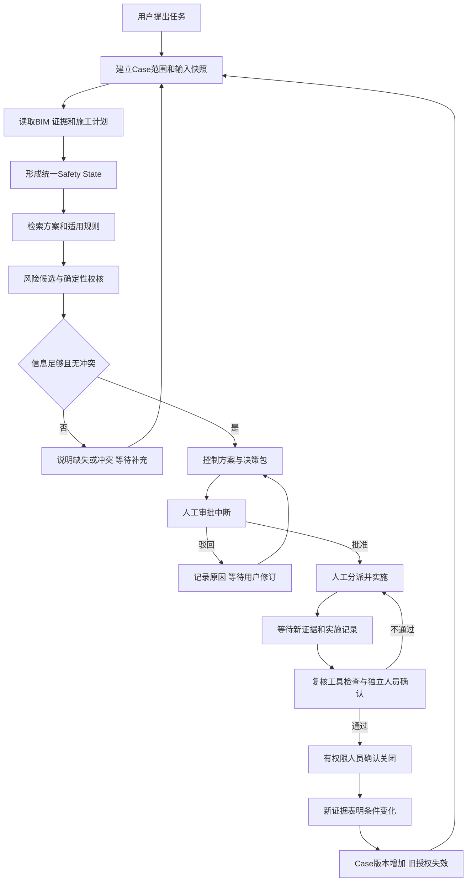

# BIM 安全协同 Agent 架构设计与开发路线

设计日期：2026年10月18日。状态：开发前设计，尚未创建后端或前端实现。依据为项目方案、已验收的DEMO-S1-001数据包、高处作业平台现有代码，以及height-work-agent-engineering skill。

范围更新：后续以组内现有平台为基础做增量完善，当前仅规划；施工方案独立业务、复杂长期记忆及全面运行恢复不作为首批目标。“重开后仍采用旧证据”按用户要求排除。当前实施范围以[现有平台开发规划修订版](D:/BIM-Safety_Coordination_Agent/docs/现有平台开发规划_修订版.md)为准，下文保留早期架构参考。

## 设计结论与首版范围

沿用Vue 3 + TypeScript + FastAPI + Pydantic + LangGraph。本地演示采用SQLite，BIM后台采用IfcOpenShell，前台采用Three.js读取离线转换的GLB并叠加演示区域与防护对象。

首版按单机、本地运行、一个项目和一个主案例设计；模型通过配置接入，不预先绑定具体供应商。现有合成证据用于稳定演示，真实S1照片作为背景。后续VLM可接入同一观察接口，输出疑似观察和置信信息。首版不把照片精确配准、结构承载计算、实时传感作为开工前置条件。

采用一个Coordinator和若干专业职责节点，共享同一Case状态、工具契约和业务事件。模块划分服务于责任、上下文和工具权限，每个文件不必对应独立进程或一次模型调用。先完成一个Case的13步闭环，再考虑自主多Agent协商。

成功标准：用户提交检查请求，系统实际查询数据、检索条款、计算空间和计划关系，生成带来源的决策包；人工批准并分派后才能实施；提交新证据后进行复核；失败可返工，条件变化可增加版本重开；关闭页面和重启服务后可继续处理待办。

## 如何参考高处作业平台

已查看D:/高处作业agent中的相关代码，仅作参考，未修改该平台。

| 已有设计 | 本项目采用方式 | 需要补充的部分 |
| --- | --- | --- |
| frontend-vue中的Vue、TypeScript、Pinia | 沿用页面、组件、状态管理的组织方式 | BIM对象选择与Case、风险、证据联动 |
| platform/tools.py中的ToolSpec、ToolRegistry和ToolContext | 沿用输入校验、角色与Agent白名单、工具日志思路 | 统一输出、单位、来源、模型版本及Case版本 |
| platform/context.py中的ContextPacket、ContextBuilder | 沿用有来源的上下文筛选 | 当前Case快照、证据轮次、规则版本及token预算 |
| platform/context.py中的MemoryManager | 沿用管理入口和显式偏好记录方式 | Case工作记忆与历史案例记忆，避免将聊天当作当前事实 |
| services/model_provider.py、assistant_model.py | 沿用模型适配、结构化输出与调用监测思路 | 为本案的任务理解、证据综合和决策包定义输入输出 |
| platform/agents.py与graph/audit_graph.py | 沿用StateGraph职责节点与工具编排 | 本案的持久化checkpoint、人工中断、恢复和版本失效 |

读到的上述主要图均使用compile()，没有传入checkpointer；UnifiedAgentState还携带app运行对象。因此不能直接把它当作可重启恢复的Case工作流。新图状态只保存可序列化的ID、版本、摘要和结构化结果，数据库连接、模型客户端及服务实例由运行时依赖提供。

参考工程依赖范围较宽，新项目实现时应锁定一次实际验证后的版本组合，不直接复制宽泛范围。只移植本案需要的代码，保留独立项目。

## Agent 职责与模型使用

| 模块 | 职责及输出 | 首版实现 |
| --- | --- | --- |
| Coordinator | 理解用户任务、确定范围、组织上下文、决定允许的下一步 | LLM任务解析＋LangGraph编排；业务权限由服务校验 |
| BIM节点 | 查询构件、楼层、区域、GUID映射与施工活动 | 确定性查询和计算，可保留bim_agent.py作为节点包装 |
| Knowledge Agent | 检索方案、规范、项目规则，输出适用来源与版本 | 先用现有结构化索引及中文词项检索，模型辅助形成查询和解释 |
| Inspection Agent | 获取现场证据，输出结构化观察、来源、时间与不确定性 | 首版读取已标注演示观察；VLM接口后接 |
| Risk Agent | 形成风险候选、关联暴露对象、请求校核并组织解释 | 数值比较和分级由规则工具执行，模型综合已验证结果 |
| Intervention Agent | 提出可执行方案、责任人、期限和验收证据要求 | 模型输出受约束的候选决策包，程序验证完整性与可行性 |
| Verification Agent | 比对本轮新证据、检查项、实施记录与剩余风险 | 确定性检查＋复核摘要，独立人员确认结果 |

与用户建议目录相比，应补上inspection_agent.py。BIM能力优先作为工具服务，避免为了Agent数量增加重复推理。方案原有的Coordinator、Knowledge、Inspection、Risk、Intervention、Verification六项职责均保留。

模型真正参与任务理解、检索问题形成、风险说明和控制方案组织；图限定其可用阶段与工具。模型不能批准自己的方案、替人完成整改、修改已确认规则或越过复核。

## 两层状态与完整工作流

业务状态由CaseService及数据库事件维护，是审批、派单、实施与关闭的权威来源。LangGraph状态维护分析进展、结果引用和等待位置。两者通过case_id、revision和domain_event_seq对齐，禁止各自独立修改一份审批状态。



图描述Case生命周期；关闭后的条件变化由新证据或人工上报触发新一轮运行，不维持一个无限后台循环。驳回后可结束该次分析，用户修订后开启新运行；控制措施或批准范围改变时应增加版本。原措施不变、仅补齐整改缺项的返工可保留版本，但增加实施轮次和新证据。

13步对应：任务创建；BIM查询；证据观察；计划查询；统一状态；规则检索；风险评估；工具校核；措施生成；决策包；人工审批；实施；复核关闭或重开。前端可逐步展开这些记录，但步骤状态必须来自实际执行事件。

LangGraph的interrupt用于等待审批、实施证据、独立复核及关闭确认，配置持久化checkpointer，使用同一thread_id恢复等待中的运行。恢复会重新执行被中断节点的开头，因此等待节点保持简洁，创建工单和记录事件放在独立业务操作中并采用幂等键。[官方中断说明](https://docs.langchain.com/oss/python/langgraph/interrupts)

### 运行身份及版本

| 字段 | 含义 |
| --- | --- |
| template_case_id | 不可变演示模板，例如DEMO-S1-001 |
| case_id | 操作者创建的运行案例，允许同模板创建多个独立案例 |
| revision | 输入、方案或现场条件变化后的案例版本 |
| run_id | 一次分析及其人工等待过程；新一轮分析使用新ID |
| thread_id | LangGraph持久化游标，首版使用该run_id；恢复沿用原值 |
| conversation_id | 对话会话，与案例及图运行分别关联 |
| input_snapshot_hash | 本轮模型、计划、证据、方案和规则版本的固定组合摘要 |

批准绑定case_id、revision、decision_id及input_snapshot_hash。收到批准时，后端检查当前版本和快照；任何关键输入变化均使旧批准失效。thread_id只是定位工作流，不是访问权限凭证。

业务操作先在事务中校验并写入事件，再唤醒图。重复提交使用idempotency_key返回同一业务结果；如果业务写入后恢复图失败，重试从已提交event_seq对齐，不能再次创建工单或覆盖批准。每个Case首版只允许一条活动写入链，避免两个运行同时覆盖方案。

## 记忆与上下文

| 类型 | 内容 | 保存与使用方式 |
| --- | --- | --- |
| 当前任务工作记忆 | 范围、当前版本、输入快照、节点结果、待办、缺失项 | 可序列化Graph State＋持久化checkpoint，供运行恢复 |
| 业务过程记录 | 决策、批准、责任、实施、复核、关闭和重开事件 | app.sqlite中的结构化事实及追加事件，不依赖模型摘要判断授权 |
| 会话记忆 | 近期对话、任务澄清、简短摘要、用户显式偏好 | conversation与message记录，经ContextBuilder筛选；按用户与项目隔离 |
| 历史案例记忆 | 已确认的风险、措施、验证结果及经验摘要 | 来源可追溯的闭环记录；首版可只保存，跨Case相似检索后续增加 |

规范、方案和图纸属于版本化知识与证据库，不当作普通聊天记忆。当前业务事实按当前版本读取，历史摘要不能覆盖“已经重开”“待批准”等现状。未经确认的模型推断不会自动升级为长期事实。

MemoryManager提供统一读取、摘要更新和历史记录入口，底层复用现有Repository；首版不建设独立记忆服务。LangGraph checkpointer与跨线程长期store用途不同，普通业务表可承载本项目明确需要的历史记录，不必把所有数据复制进图内。[官方持久化说明](https://docs.langchain.com/oss/python/langgraph/persistence)

ContextPacket建议字段为source_type、source_id、content、project_id、case_id、revision、observed_at、valid_from/valid_to、model_version、origin、locator、relevance和token_count。按节点选取字段，不要求所有来源都有同一类型的时间。

ContextBuilder先限定项目、区域、时间和版本，再选择当前Case事实、最新证据、工具结果、适用条款及相关方案片段，最后补充必要的对话与历史。预算以目标模型token计量；过长内容保留检索引用和摘要，必需依据不足时返回缺失。IFC、照片原始字节、整个数据库和全部聊天记录不进入文本提示词。

## 工具契约与权限

| 工具组 | 首版能力 | 核心约束 |
| --- | --- | --- |
| BIM | 查询构件属性、GUID映射、区域包围盒 | model_id＋model_version；真实与叠加对象分开 |
| Schedule | 按区域、时间和版本查询活动，计算重叠 | 区分历史原计划、演示计划、实际确认状态 |
| Evidence | 查询证据及观察、关联强度、轮次 | 原照片与合成图明确标记，不将fixture标注声称为VLM结果 |
| Knowledge | 检索规范、规则和施工方案片段 | 返回条款、版本、页码及适用条件 |
| Geometry | 距离、路线与危险区相交、区域包含等 | 单位和坐标系明确，区分粗包围盒与精细几何 |
| Rules | 确定性验收比较、风险分级和条件检查 | 经确认的声明式规则；输入缺失或冲突返回不足以判定 |
| Case History | 查询当前状态、决策及历史事件 | 只读，不通过回忆或聊天更改业务事实 |

统一ToolSpec保存名称、说明、Pydantic输入/输出模型、允许节点、角色和读写属性。ToolContext由服务器注入当前身份、项目、Case和版本，模型不能自行指定角色或扩大范围。

ToolResult至少包含status（ok/insufficient_data/error）、data、sources、input_snapshot_hash、tool_version、warnings与duration_ms。相关空间结果附坐标系和单位。Registry负责参数校验、权限、超时和调用日志，工具内部完成外部格式归一化。

审批、分派、开始、提交证据、复核确认和关闭使用受控业务API，不暴露为允许LLM自由调用的写工具。模型只产生建议或草稿。数值规则、空间计算和版本校验由程序执行；源文件中的文字不能更改工具权限。

首版工具直接采用Python函数和注册表；无需先把内部工具包装为MCP，也无需A2A、Redis或知识图谱。工具选择采用白名单和有限步数，不能让模型无限循环或直接执行生成的Python与SQL。

## BIM和知识的数据链路

IFC离线处理产生版本化构件索引、空间查询缓存、区域GLB及mesh/GUID映射。首个演示区域先轻量化，不在每次模型调用时解析数百MB IFC。Three.js展示GLB与演示叠加层，点击风险可定位到相关区域和源构件；GLB只承担显示，工程查询仍以后台索引和几何工具为准。

转换时显式处理IFC的Z轴向上、浏览器场景轴向、米制单位及模型原点，保存变换矩阵，源GUID与前台mesh标识可互查。演示OPEN-01保持authored_demo来源，不能在显示时改成真实IFC洞口。IfcOpenShell提供几何处理能力；Three.js提供GLTFLoader用于glTF加载。[IfcOpenShell几何文档](https://docs.ifcopenshell.org/ifcopenshell-python/geometry_processing.html)、[Three.js GLTFLoader](https://threejs.org/docs/pages/GLTFLoader.html)

规范按“规范版本—章—条”组织；方案按章节和控制措施组织，保留页码或段落定位。现有10条规则先做可测的词项检索，证明来源和适用性正确，再决定是否补入向量检索。规范要求、演示项目自定阈值、模型建议分别标记，不将三者混成同等效力的结论。

## Web接口与可见过程

Vue页面围绕同一Case组织：总览、BIM与证据、风险与依据、决策审批、整改实施、独立复核与时间线。BIMViewer、AgentTrace、RiskPanel、EvidencePanel作为共享组件。

FastAPI提供Case读取及创建、分析运行、审批、分派、实施记录、证据提交、复核和关闭接口。首版可用演示身份切换，但由后端验证角色与状态；模型请求不能直接决定身份。具体URL在实现时按这些业务动作保持简洁。

前端通过SSE读取node_started、tool_started、tool_completed、decision_ready、human_action_required、case_updated、run_failed等事件；人工动作通过普通POST提交。事件持久化并带seq，断线后按序续读。LangGraph支持流式节点更新和自定义工具事件，后端将其归一化为稳定的前端事件协议。[官方流式说明](https://docs.langchain.com/oss/python/langgraph/streaming)

AgentTrace显示实际节点、工具、参数摘要、来源、输出、耗时及错误。模型说明与工具事实分开。存在真实模型调用与固定回放两种模式，界面明确标识；模型失败返回可见错误或由用户选择回放，不能静默换成预置答案。

耗时分析由本地运行器执行，API及时返回run_id。待办、运行状态和checkpoint落盘，启动时可恢复未完成运行；不把仅在内存中的BackgroundTasks当作可恢复持久任务。演示首版先限制单个活动分析，后续有并发需求再扩展。

## 建议目录

以下是待实现结构，不在本轮预建空模块。保留已经准备好的data路径，避免重复搬运原始数据。

```text
BIM-Safety_Coordination_Agent/
├── backend/app/
│   ├── main.py
│   ├── config.py
│   ├── schemas.py
│   ├── repository.py
│   ├── api/                  # Case、运行、审批、实施与复核
│   ├── agents/
│   │   ├── coordinator.py
│   │   ├── bim_agent.py
│   │   ├── knowledge_agent.py
│   │   ├── inspection_agent.py
│   │   ├── risk_agent.py
│   │   ├── intervention_agent.py
│   │   └── verification_agent.py
│   ├── graph/
│   │   ├── state.py
│   │   └── workflow.py
│   ├── domain/case_service.py # 唯一业务状态变更入口
│   ├── tools/                # 契约、注册、工具适配
│   ├── memory/               # 记忆入口、上下文筛选
│   ├── llm/                  # 模型适配、结构化输出
│   ├── bim/                  # IFC解析、几何、空间和进度查询
│   ├── knowledge/            # 规范与方案检索
│   └── rules/                # 确定性规则及验收
├── frontend/
│   └── src/
│       ├── pages/
│       ├── components/       # BIMViewer、AgentTrace等
│       ├── stores/
│       └── api/
├── data/
│   ├── external/s1/          # 现有原始数据与审计
│   ├── demo/s1_case_001/     # 现有模板和固定分支
│   └── processed/            # 待生成模型缓存与GLB
├── runtime/                  # 本地运行状态，独立于演示模板
│   ├── app.sqlite
│   ├── checkpoints.sqlite
│   └── uploads/
├── scripts/                  # 保留已有数据准备和回放脚本
├── tests/
└── docs/
```

现有demo.sqlite只作为模板种子，运行实例写入runtime/app.sqlite。现有scripts/demo_case.py只接受scripted_demo事件，保留它作为回放基线；实施时将已验证的状态约束迁移至CaseService并补充真实用户事件入口，不能通过伪造scripted_demo来绕过限制。

## 实施顺序与验收

| 顺序 | 本轮要完成的能力 | 可验证的完成条件 |
| --- | --- | --- |
| 1 | 业务Case API＋运行库＋最小页面 | 从模板创建独立实例，人工走通四条已有分支；重置实例不影响模板 |
| 2 | LangGraph＋模型适配＋工具注册＋Trace | 文本请求产生实际工具调用及来源齐全的结构化决策包；不是播放预置时间线 |
| 3 | checkpoint＋人工中断＋记忆上下文 | 审批等待时重启服务可继续；重复批准不重复派单；新版本拒绝旧授权 |
| 4 | BIM区域GLB与证据联动 | 风险定位正确，GUID可回查，来源标签和坐标变换一致 |
| 5 | 端到端展示及异常评估 | 模型超时、输入缺失、规则冲突、复核失败均有明确可恢复状态；四条流程稳定演示 |

保留当前15项数据与流程测试，新增业务API权限、项目与Case隔离、规则边界、版本失效、恢复幂等、证据新鲜度、模型输出校验、引用真实性及SSE断线续读测试。模型质量另用固定输入评估任务范围、工具选择、条款召回、解释与工具结果一致性、延迟和调用成本。

第一条纵向切片仍以DEMO-S1-001为范围：从用户检查请求到带证据的决策包，再到人工操作与复核闭环。首版必须具备模型适配、工具、状态、上下文、持久化、人工关口和日志；向量库、长期记忆的相似检索、VLM、更多项目及分布式执行按实际演示收益逐步增加。

参考skill：[高处作业安全Agent工程经验](C:/Users/ygt/.codex/skills/height-work-agent-engineering/SKILL.md)。该skill用于设计提示，并未要求本项目必须采用多Agent或特定协议。
