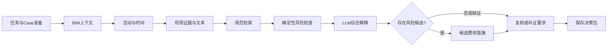
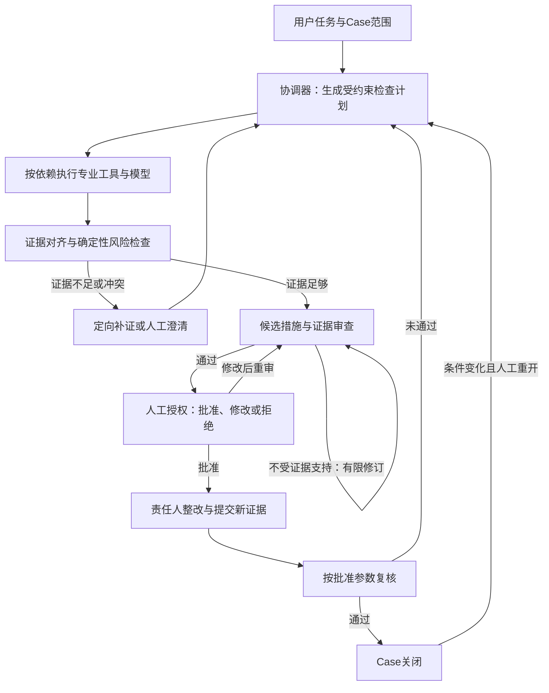

# BIM 施工安全协同 Agent：架构现状与升级规划

核对日期：2026-10-19。本文件为架构与论文方法规划；未修改网站代码、模型配置或运行中的案例。以下明确区分现有实现和待开发设计。

## 1. 当前系统的准确定位

当前是以 Safety Case 为业务载体、由 LangGraph 编排的任务型 Agent。LLM 在约束范围内理解任务、选择检查重点和部分工具、组织风险解释与措施；BIM、几何、活动时空关系、规则与复核由专业程序执行；人工负责观察确认、措施批准、整改记录及复核确认。

工程形态：Vue 3 + Three.js → FastAPI → LangGraph / 专业工具 / DeepSeek 与 Qwen → SQLite、IFC / GLB 与文件资料。

可以称为“多角色协同的 Agent 工作流”。当前六类角色主要是职责划分，尚不宜称为六个能够分别自主规划、互相协商的独立 Agent，更不是分布式 Agent 系统。

### 1.1 当前真实分析图

`agent.py` 的 StateGraph 有 10 个节点：

1. prepare：固定 Case、模型、区域和检查时刻，生成 TaskSpec。
2. bim_context：查询 BIM；按任务需要计算人员点至标注边线的距离。
3. schedule：检查活动时间窗；存在活动计划且任务需要时执行时空冲突检查。
4. inspection：必要时调用 Qwen 获取图像观察候选，检查已确认观察及证据匹配；可提取和对齐现场文本。
5. knowledge：检索当前检查时刻有效的规范条款。
6. risk：执行确定性风险检查，汇总时空冲突和文本差异。
7. llm_reasoning：DeepSeek 根据工具结果形成风险说明，并校核引用和工程数值。
8. intervention：仅风险候选分支进入，基于基础措施生成受约束的控制建议。
9. verification_plan：整理所需复核资料和要求。
10. finalize：保存结果、决策包、状态和审计记录。

范围不支持或任务需澄清时，prepare 可以直接进入 finalize；这条提前退出路径未在简图中展开。

### 1.2 当前业务闭环与分析图分开实现

Case 的主要业务状态为：draft → analyzing → needs_evidence / pending_review → approved → rectifying → pending_verification → closed / reopened，另有 rejected 等分支。无整改需求的正常检查有对应审核关闭路径。

人工审核、整改实施和最终复核目前通过 FastAPI 业务接口与数据库状态机完成。分析图在保存决策包后结束，不是一个使用 LangGraph interrupt 等待人工、然后继续执行的长生命周期图。

### 1.3 已实现能力及边界

| 模块 | 已实现 | 当前边界 |
| --- | --- | --- |
| 任务规划 | DeepSeek → Pydantic TaskSpec；检查重点、工具白名单、检索词、澄清 | 五个核心工具必须保留，主要调节少量可选工具；未生成通用子任务依赖图 |
| BIM | IFC GUID / 楼层 / 类别、局部几何、距离、区域联动；19 层总览 | 完整安全检查限于 L05；未完成全楼自动临空面识别 |
| 图像与文本 | Qwen 图像候选、DeepSeek 文本候选、段落引用、人工确认与差异澄清 | 候选不等于现场事实；米制参数不能从照片直接认定 |
| 知识检索 | 规范种子、FTS5 / BM25、关键词加权、时间有效性、页码 | 面向有限条款集；未实现大规模混合检索或完整知识图谱 |
| 风险与复核 | 确定性检查、未知字段门控、批准验收参数、时间与范围核对 | 领域覆盖有限；不是结构、强度或全部施工规范的自动合规审查 |
| 记忆 | 同 Case / actor 的近期消息，默认最多 6 条、正文预算 6,000 UTF-8 字节；结构化 Case 状态 | 非长期项目经验检索；actor 标识不构成真实用户认证 |
| 输出约束 | JSON / Pydantic、引用 ID 白名单、工程数值检查、受约束措施生成 | 引用存在、数值在白名单中，不等于整句语义都获得证据支持 |
| 运行记录 | run / 事件 / 工具轨迹、真实调用耗时和 token、流式摘要、版本记录 | 未接入持久化图检查点，不能宣称任意节点崩溃后精确续跑 |
| 人工授权 | 批准 / 修改 / 拒绝、措施版本、确认复核 | 当前演示身份，尚无完整登录、项目权限和角色授权体系 |

HTTP 分析入口使用 FastAPI BackgroundTasks 执行。图编译没有传入 checkpointer；数据库业务记录持久化与图运行检查点持久化是两件事。当前工具有有限重试，但缺少按故障类型区分的完整恢复策略。

现有 61 项测试属于功能与回归验证，不能直接作为论文有效性实验或工业可靠性认证。

## 2. 建议升级后的方法定位

建议使用描述性名称：**证据驱动、约束规划、人工授权的 BIM 安全协同 Agent 框架**。

目标是增强可检验的决策与执行能力：根据缺失证据选择下一步、将每个结论关联到具体依据、在授权与版本约束下恢复运行。继续沿用 Vue 3、FastAPI、LangGraph、DeepSeek 和 Qwen。六类专业职责可以保留，只有确需语义推理的节点才调用大模型。

### 2.1 总体分层

1. 交互与业务层：BIM 工作台、任务、现场资料、审核、整改、复核、报告。
2. Case 与授权层：任务边界、权威业务状态、版本、责任主体、权限及授权记录。
3. 协调与运行层：任务规划、工具执行、证据检查、有限重规划、人工中断和运行恢复。
4. 专业能力层：BIM / 几何、活动时空计算、VLM 感知、规范检索、规则与复核。
5. 数据与可追溯层：原始文件、结构化观察、证据关系、规则版本、记忆、运行日志。

这是待开发架构，而非当前系统能力清单：

拒绝、取消、预算耗尽和无法补证时均有明确的终止 / 等待状态。图中的循环都必须设次数、调用成本和时间预算；不得无限自我反思。

## 3. 六项实质增强

### 3.1 从选择工具名称升级为生成可验证计划

计划包含子目标、工具及经过 Schema 校验的参数、依赖关系、所需证据、预期输出、停止条件和预算。执行器验证权限和前置条件后调用工具；不允许模型自由执行 Python、SQL 或越过人工批准。

例如“全面检查 L05 临边与人员暴露”分解为：固定范围 → 取得构件 / 活动 → 整理观察 → 检查证据适用性 → 栏杆检查与人员距离检查 → 汇总依据 → 提出措施。只查栏杆高度时，按规则保留必需步骤，省略无关的可选空间调用。

对“栏杆高度未知”，生成明确补证任务“确认高度与测量来源”；补证后只重新计算受影响的检查项。对照片与文字冲突，保留原始观察和引用，由人工澄清。不能为实现闭环而补写未知数值。

第一版采用可解释的条件路由和缺口优先策略，不宣称已经训练出最优工具策略。

### 3.2 建立事实与证据的可追溯关系

为每条事实记录：对象 GUID、区域、活动与时段、属性、值与单位、来源、来源版本、观察 / 确认状态、确认人、关联检查与条款。

组织关系：**检查结论 → 输入事实 → 证据原件 / 几何计算 → 条款及适用条件 → 措施 → 人工授权 → 复核结果**。

新增资料通过项目、模型版本、对象、位置与时间对齐；图片候选、人工确认和演示模拟分开标记。规则参数保留来源和人工核对版本。关系先用结构化表和引用实现，不要求引入 Neo4j。

首期不做整栋拓扑重建，也不改变用户已约定保留的预置证据 / 重开选择策略；把实际使用的证据及其版本记入快照。

### 3.3 增加独立的证据与结论审查

在正式决策包前审查：必要证据是否齐全、引用是否真的支持结论、工程参数来源是否明确、规范是否适用、观察与措施是否矛盾、是否把候选写成已批准 / 已执行。

确定性检查负责范围、时间、版本、单位、阈值和权限等硬约束。可选的 LLM 审查仅辅助检查解释的语义支持关系，返回问题与引用，不能推翻工程规则或赋予自己批准权。同模型重复生成并不天然构成独立正确性保障。

审查不通过时定向修订或请求补证；重试耗尽后转交人工，保留失败依据。

### 3.4 区分三类记忆并按需构建上下文

- 工作记忆：本次计划、已取得事实、缺口、工具结果引用和预算。
- Case 记忆：同一案例的对话、观察、措施与批准版本、整改及复核历史。
- 项目经验：仅按权限检索经审核的历史案例和处置经验，保留原范围、版本和来源。

经验只能辅助推荐，不是当前现场的新证据；演示模拟闭环不能晋升成真实现场合格事实。模型上下文只载入当前子任务所需的摘要与引用，不载入整份 IFC 或全部历史聊天。

规范库先完善条款层级、适用条件和版本链。资料规模扩大且检索实验显示有收益后，再加入向量检索 / 重排，与现有 FTS5 作比较。

### 3.5 把长生命周期 Case 做成可恢复执行

保留业务数据库作为 Case 状态、授权和版本的权威来源；LangGraph 检查点用于恢复执行位置和已完成工具结果，两者不能分别随意改写业务真相。

拟接入持久化 checkpointer 与人工 interrupt / resume。批准接口先校验身份、Case 版本和措施版本，成功记录授权后再唤醒等待中的图。审批时图不占住工作线程；重启后可在一致性校验通过的情况下继续。

将请求内后台任务升级为可追踪的持久任务与独立 worker，包含任务领取、心跳 / 超时、取消、失败分类和有限重试。每个产生副作用的操作使用幂等标识或结果检查；恢复不能重复写整改、重复批准或意外反复调用收费模型。未完成的外部调用可能需要重试，不承诺跨外部系统的天然 exactly-once。

快照只保存小型状态和文件 / 几何引用，不复制大 IFC、GLB 或照片。先做当前单机环境的可靠运行；多用户部署时再评估 PostgreSQL、持久队列和对象存储。

本地已确认 langgraph 1.0.10 的 compile 支持 checkpointer，且提供基础 interrupt；SQLite / PostgreSQL checkpointer 扩展包目前未安装。开发时需单独锁定兼容版本和测试，不直接照搬新版文档的新增 API。

### 3.6 形成真实的授权与可观测机制

增加项目范围权限，以及检查人、审核人、整改人、复核人的服务端授权。证据按访问权限读取，模型只调用授权工具；上传文字与照片内容作为数据，不能改变系统权限。

补齐每个任务 / 节点的耗时、调用次数、输入版本、规则版本、错误类别、取消 / 恢复事件和成本。保存事件不等于防篡改审计，若有真实合规要求，再设计独立审计存储和保留策略。

## 4. 开发顺序与验收门槛

| 阶段 | 建设内容 | 验收目标 |
| --- | --- | --- |
| A：证据基础 | 统一工具契约、事实 / 引用关系、输入快照、检查结果与参数来源 | 从任一报告结论追到证据、输入值、条款和措施版本；未知与模拟来源不丢失；原 61 项回归保持 |
| B：Agent 行为 | 子任务计划、条件路由、证据缺口驱动重规划、独立审查 | 不同任务触发不同可选工具；能定向补证并局部重算；错误引用 / 矛盾说明被阻断；达到预算则等待或退出 |
| C：运行与授权 | 持久检查点、人工中断、持久 worker、幂等、角色权限和上下文记忆 | 处理中断电 / 重启可恢复；不重复授权或记录整改；版本过期拒绝执行；无权限用户不能审批或读取其他项目资料 |
| D：论文实验 | 冻结数据、对照基线、消融、错误分析和复现实验包 | 同输入 / 模型 / 工具预算下可重复比较；同时报告正确率、错误关闭、补证和成本，不只统计闭环数 |

阶段 A 与 B 形成论文方法主线，阶段 C 提供工程落地证据，阶段 D 验证方法价值。先在当前 L05 范围完成这一闭环，再决定是否扩大空间范围和风险种类。

## 5. 论文应回答的问题

拟验证的贡献不是“使用 Vue / LangGraph / 多 Agent”。可将方法集中到三个待检验机制：

1. 面向 BIM 对象与施工活动的时空、版本和来源约束，能否减少跨区域或过时证据导致的错误判断？
2. 证据缺口驱动的受约束规划，能否在保证检查要求的情况下提高补证效率、减少无关调用？
3. 可追溯检查与人工授权闭环，能否降低证据不足时错误关闭 Case 的比例，并提高重启后的流程一致性？

技术名词和组合本身不证明学术新颖性；新颖性仍需另行检索相关工作并对比。论文表述应与真正完成的开发和实验一致。

### 5.1 实验设计建议

对照可包括：直接 LLM + 检索、本系统当前固定顺序工作流、升级后的受约束自适应框架。固定模型版本、输入资料、规则集和资源预算；明确各基线可访问的工具和证据，避免把额外数据带来的收益误认为规划收益。

对升级框架分别移除动态规划、证据一致性审查、案例记忆，测量其影响。涉及移除安全约束的对照仅在离线实验运行。

案例覆盖防护缺失、栏杆偏低、正常检查、关键字段缺失、照片 / 文本冲突、错误 GUID / 区域、时间或版本不符、活动时空冲突、复核失败、模型 / 工具超时与进程重启。保留已标注人工模拟的可控案例，并单独报告真实现场资料的验证范围。

按原始照片、构件 / 区域或场景分组划分开发和测试集，避免同一图片只改几个参数后同时出现在两侧。由领域人员提供参考判定和所需证据清单；不能只用模型互评。

主要指标：

- 风险识别准确率 / 召回率，以及正常与缺证场景的正确处理率。
- 应阻断案例中被错误关闭的比例；对真正满足条件的案例另报正确关闭率。
- 引用 ID 有效率与结论获得证据支持的比例，二者分开统计。
- 规范检索召回 / 适用性与工程参数正确率。
- 补证命中率、额外调用数、端到端延迟和 token / 费用。
- 失败恢复成功率、重复副作用次数、未授权 / 过期版本操作阻断率。

论文中当前可用的保守表述：

> 系统构建了以统一 Safety Case 为载体的 BIM 施工安全协同原型。协调模块在任务范围与工具约束下生成结构化检查计划，专业模型与工程工具产生候选观察、几何结果和规则检查，大语言模型据此组织解释和控制建议；系统通过证据来源记录、人工授权与整改后复核维持可追溯闭环。

升级完成并通过实验后，才可进一步描述动态重规划、持久恢复和项目经验检索等新增机制。现阶段适合定位为“面向工程部署的可审计研究原型”，不宣称已完成工业现场规模化验证。

## 6. 代码核对位置与技术依据

当前实现关键位置（相对交付包 `BIM-Safety-Coordination-Agent/02_网站源码/backend/app/`）：

- `agent.py:659`：真实图结构及无 checkpointer 的 compile；`agent.py:750`：运行执行。
- `coordinator.py:31`：TaskSpec；`:72`：上下文；`:110`：任务规划。
- `tools.py:399`：FTS5 / BM25 与关键词检索；`:503`：风险计算；`:697`：复核。
- `live_model.py:61`：受约束措施生成；`:118` 附近：解释引用与工程数值校核。
- `services.py:514`、`:679`、`:781`：人工审核、整改、复核业务状态迁移。
- `main.py:504` 附近：FastAPI BackgroundTasks 分析入口。

官方文档用于确认架构能力，不构成本文方法新颖性的文献依据：

- [Workflows and agents](https://docs.langchain.com/oss/python/langgraph/workflows-agents)：预设工作流与动态 Agent 的区别。
- [Checkpointers](https://github.com/langchain-ai/docs/blob/main/src/oss/langgraph/checkpointers.mdx)：图状态持久化与恢复。
- [Interrupts](https://docs.langchain.com/oss/python/langgraph/interrupts)：人工暂停与恢复；注意节点恢复会重执行中断前代码，需处理副作用。
- [Functional API 的幂等说明](https://github.com/langchain-ai/docs/blob/main/src/oss/langgraph/functional-api.mdx)：任务重试与副作用处理原则；当前项目仍使用 Graph API，不要求迁移到 Functional API。
