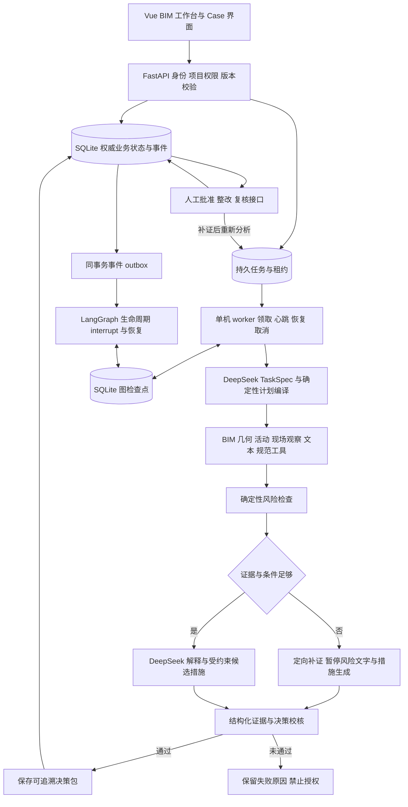

# BIM 安全协同 Agent 2.0 实现说明

2026-10-19。本文说明已经落地的本机研究原型，替代上一份规划中的“待开发”描述；原规划文件保留作为设计记录。系统继续使用 Vue 3、FastAPI、LangGraph、DeepSeek 与 Qwen，业务载体仍是同一 Safety Case。

本版定位为**证据驱动、约束规划、人工授权的 BIM 安全协同 Agent**。确定性工具提供工程判断，LLM 理解任务并组织文字，业务状态机负责授权与关闭。六类角色是协调、知识、观察、风险、干预、复核的职责划分，不应描述成六个独立自主协商的 Agent。

## 1 已实现的架构

当前 worker 是应用内的单个后台线程，领取状态、租约、输入和图检查点写入磁盘；不是独立队列集群或多机执行器。HTTP 请求完成后，任务仍由持久记录驱动。分析重启恢复与业务授权是两条不同链路。

### 分析图

12 个节点：prepare → bim_context → schedule → inspection → knowledge → risk；风险节点按条件进入 request_evidence，或进入 llm_reasoning → intervention（仅风险候选）；随后 verification_plan → assurance → finalize。任务范围需澄清时可从 prepare 提前进入 assurance。

request_evidence 由缺字段、时间不匹配、活动资料不完整或文本冲突等条件触发。它生成明确补证清单并暂停后续生成，不让模型补写高度、人员状态或“已整改”等事实。资料补齐后另启一轮分析；未变化且允许缓存的只读步骤可以复用。

### 人工生命周期图

业务状态仍由原状态机控制：draft → analyzing → needs_evidence / pending_review → approved → rectifying → pending_verification → closed / reopened，保留 rejected 和正常检查直接审核关闭分支。

LangGraph 的生命周期图使用实际 `interrupt()` 保存等待位置，分别等待分析、补证、审核、整改、整改后资料或复核。业务接口先完成身份、版本、状态校验并提交记录，outbox 随后更新等待图。恢复信号只携带已提交版本；图不执行批准、整改或关闭。业务数据库为权威来源，检查点用于恢复执行位置。

## 2 AI 程序与人工的边界

| 环节 | AI 可以做 | 必须由程序或人工完成 |
| --- | --- | --- |
| 任务规划 | 生成检查重点、白名单工具选择、检索词、澄清候选 | Schema、范围、必需步骤、依赖、只读权限和预算由程序固定 |
| 图像与文字 | Qwen 观察候选、文本提取与差异候选 | 人工确认观察和来源；未知米制数值不得由图片自动认定 |
| BIM 与进度 | 解释已执行结果 | GUID、模型版本、点到线距离、时间窗、活动体积交集由程序计算 |
| 风险 | 基于工具结果组织解释 | 工程阈值、缺字段门控、风险结果由确定性检查决定 |
| 整改措施 | 在基础要求内组织候选措辞 | 不得降低验收参数，不得批准自己或声称已经实施 |
| 校核 | 现有文字输出约束继续生效 | 新审查器校核结构化事实、单位、引用、规则版本、未知门控与阈值 |
| 审核整改复核 | 提示当前待办 | 人工批准、记录整改、确认复核；程序比较已批准参数与新证据 |

模型 API 不可用时返回失败，保留资料和原因，不静默切到规则演示模式。`.env` 与密钥不进入运行包、前端或测试报告。

## 3 受约束计划与补证策略

`TaskSpec` 继续使用 Pydantic 校验。程序将其编译成子目标、工具、类型化参数、前置依赖、预期结果及停止条件。五个核心工具固定保留：bim_query、schedule_query、evidence_check、rule_retrieval、risk_assessment。人员暴露检查必须保留 spatial_check；活动和文本资料存在时不能绕过相应检查。

所有计划工具均为 read 权限，没有 approve / implement / close 工具。参数由当前 Case 编译，LLM 不能更换项目、模型版本、GUID 或检查时刻。当前按受控 StateGraph 顺序执行，尚不是任意 DAG 调度器或学习得到的最优规划器。

预算：每工具最多 2 次尝试，每轮最多 12 次模型调用、480 秒；每运行最多 3 次任务领取。计划记录最多 2 次重规划预算，当前实际缺证分支只生成一次补证计划，然后等待人工，避免循环消耗。取消请求在当前外部调用返回后的安全边界生效。

只缓存同案、输入相关部分一致的 BIM、空间、活动时间窗和规范检索结果，保存来源运行与输入摘要。现场观察、风险、授权和复核不会按旧结果直接通过。缓存命中在轨迹中明确标记，不显示成一次新的计算。

## 4 输入快照与证据依据

每轮保存逻辑输入快照和 SHA256：Case 范围与任务、模型/版本、区域、证据元数据与文件哈希、确认观察、规则库、活动计划、现场文本及澄清记录。快照保存文件引用，不复制大 IFC、GLB 或图片。文件哈希按路径、大小和修改时间缓存计算。

恢复分析、写入结果、批准新决策包前重新比较输入。输入已变化则拒绝旧结果，要求重新分析。结果写入还检查最新 run 与 Case 状态，防止旧运行覆盖新的流程。审核记录绑定分析输入哈希；复核记录另存批准要求、当次观察、实际证据文件哈希及复核时刻的输入哈希。

决策包新增 `execution_plan`、`evidence_trace`、`assurance`、`evidence_gaps` 和分层记忆摘要。证据关系包含对象 GUID、区域、时间、事实值与单位、simulation / human_confirmed / candidate 来源、几何计算、检查项、规范页码/版本与措施引用。授权与最终复核继续保存在 Case、事件和版本快照中。

结构化审查器检查事实是否与观察一致、单位是否一致、规范是否有效且版本一致、风险和措施引用是否闭合、未知项是否被写成无问题、缺证是否产生可批准措施、候选参数是否降低阈值。审查失败阻止正式决策提交。

这是**确定性的结构化一致性审查**。它不证明任意自然语言句子得到语义蕴含，也没有增加一个同模型“投票审查员”。自由文本仍需人工审核；不能把引用 ID 存在率写成事实支持率。

## 5 记忆与运行可靠性

工作记忆包含当前计划、事实引用、缺口与预算；Case 记忆保留消息、批准版本及处置历史；项目经验只检索同项目、模型版本、actor 且构件重叠、已经复核关闭的最多 3 条案例索引。

本次经验内容为案例编号、标题、区域与使用标记，仅作流程参考；演示闭环不会晋升成当前真实现场事实。对话上下文仍最多 6 条、正文累计 6,000 UTF-8 字节，不将整份 IFC 或全部聊天放入提示词。

分析图使用 `langgraph-checkpoint-sqlite==3.0.3`，图执行采用同步检查点提交。任务租约 18 秒、心跳 3 秒；进程退出后可重新领取并恢复未完成节点。已完成节点无需重做；同一个节点中未提交完成的外部调用仍可能重试，不承诺跨模型服务的 exactly-once。

分析提交有幂等检查。已保存决策、尚未更新运行成功标记时发生崩溃，恢复只补运行状态，不重复写业务事件或推进 Case 版本。节点前后校验取消、时间和调用预算。失败保留可恢复性分类，过期输入、审查失败、取消或预算耗尽不能直接续跑。

业务事件与 outbox 同事务保存，生命周期图随后接收事件；交付错误会记录在运行状态。当前不是不可篡改审计库，也没有跨进程分布式锁或跨机事务保证。

## 6 权限与默认演示方式

默认 `ACCESS_MODE=local_demo`，仅本机回环访问，以可信本机演示操作员操作；无需新增登录步骤。输入的“演示安全员”等姓名是显示记录，不会提升权限。

可选 `ACCESS_MODE=token`：服务端检查 viewer / inspector / reviewer / rectifier / admin 角色和项目范围；审批/复核、检查、整改操作分别授权。令牌仅保存哈希，支持撤销；页面用令牌换取 HttpOnly、SameSite=Strict 会话 Cookie，供 API、原生图片与 SSE 同时使用。写操作记录真实主体、角色、路径与状态码。

这提供本机及小范围试用的角色控制，未接企业 SSO、组织人员目录或正式电子签名。本轮未创建操作员令牌、未修改 `.env`，也没有开放公网访问。

## 7 验证与论文表述

后端 **85 项测试通过**，前端 `vue-tsc --noEmit` 与 Vite 生产构建通过。测试覆盖原 61 项能力，以及计划依赖、事实篡改、规则变化、缺证阻断、恢复与取消、预算、项目越权和角色权限等场景。

恢复测试包括两个实际子进程强制退出：完成 BIM 节点后退出，以及业务结果提交后、运行成功标记前退出。恢复后分别验证已完成 BIM 不重算、业务记录不重复写入。测试使用独立临时数据库，不重置操作员数据库。

真实网页案例 `CASE-20261019-1A75FF` 使用 EV-003 → EV-010，经过 DeepSeek 分析、人工批准、内置整改资料、确定性复核关闭，3 次模型调用共 7,701 tokens。缺证案例 `CASE-20261019-29D33A` 从失败节点恢复，任务规划只调用 1 次模型，共 1,501 tokens；5 项缺口、无措施，审批返回 409。它保留了开发中契约兼容问题的失败及恢复轨迹。

隔离工程回放中，固定顺序与受限自适应两组均为 11/11 状态/结果符合预期、错误无问题判定 0；自适应组有 4 次只读缓存命中，模拟摘要步骤由 10 次减为 6 次。该对照没有真实 LLM 调用，同时改变补证路由与缓存开关，不能分离两个机制的效果，不能用来宣称大模型准确率、费用收益或统计显著性。

论文可据实介绍：基于对象/活动/来源/版本约束的可追溯 Safety Case，受约束计划与证据缺口分支，独立结构化校核，人工授权和持久恢复。下一步论文实验仍需领域人员标注、分组冻结测试集、同模型同预算基线、单因素消融、多次真实模型运行和错误分析；这些工作尚未完成。也未做全楼安全检查、现场规模化验证或完整自然语言证明。

## 8 主要代码与资料

代码相对交付包 `02_网站源码/`：

| 能力 | 入口 |
| --- | --- |
| 计划与上下文 | backend/app/coordinator.py；assurance.py:109 |
| 事实依据与校核 | backend/app/assurance.py:171、:229 |
| 分析图与缺证分支 | backend/app/agent.py:625、:640、:728 |
| 快照与恢复执行 | backend/app/assurance.py:39；agent.py:824 |
| worker 与人工中断 | backend/app/durable.py:54、:109、:147 |
| 身份与项目权限 | backend/app/access.py；main.py |
| 审核与复核输入绑定 | backend/app/services.py:529、:805 |
| 前端计划依据面板 | frontend/src/components/AgentAssurancePanel.vue |
| 工程验证 | backend/tests/test_agent_assurance.py；test_durable_runtime.py；test_access_policy.py |
| 离线回放 | backend/scripts/evaluate_safety_policy.py |

验收数据、运行包和导出回归保存在交付包 `03_测试与验收/Agent框架升级_20261019/`；网页截图在 `04_演示与截图/Agent框架升级_20261019/`。
